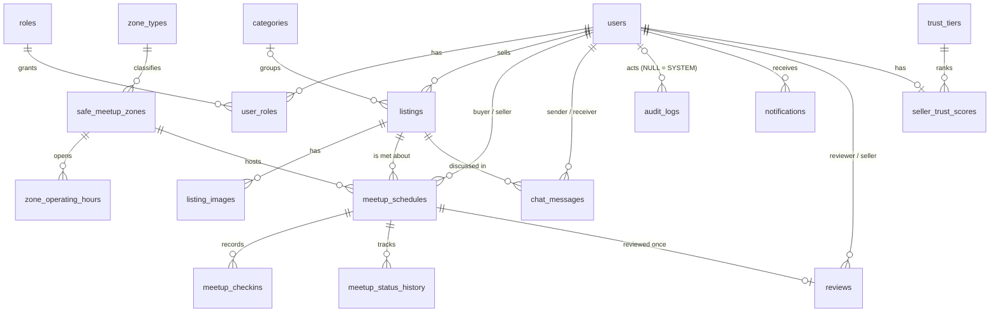

# BentaHub (SIA, Independent Track)

A peer-to-peer marketplace where every deal ends in a **safe meetup**. Buyers and sellers book a meetup at a verified Safe Zone (mall desk, police booth, barangay hall). The system enforces the safety rules automatically and builds a trust score for sellers.

**Stack:** Node.js + Express (MVC), MySQL, JWT auth, plain HTML/JS + Tailwind frontend.
**Team (6):** Ijan (repo admin), Cabugnason, Espiritu, Gemina, Ib-Ib, Dinglasan.

## Unique major feature: Safe Meetup Scheduling Engine
Split between two owners (required for a group of 6).

| Part | Owner | What it does automatically |
|---|---|---|
| Rules | Espiritu (`models/meetupModel.js`) | Rejects a booking unless: zone active and open for the whole meetup, listing active, buyer is not the seller, time is in the future, **zone not over its `max_concurrent` capacity (409)**, **neither person is double-booked (409)**. Zone row is locked inside a transaction so the last slot can't be double-sold. Status moves only along allowed transitions; completing needs both people checked in. |
| Workflow + alerts + audit | Cabugnason (`models/workflowModel.js`, `auditModel.js`, `notificationModel.js`) | Every minute (and on demand) overdue pending/confirmed meetups become `expired`, with a status-history row, a SYSTEM audit entry, and an alert to both users. |
| Trust (extension) | Gemina (`models/reviewModel.js`) | Each review recalculates the seller's average and tier. A tier needs BOTH a min average AND a min number of reviews. |

**Demo with seed data (edge cases built in):**
1. Meetup #1 is at the Police Station Booth (capacity 1), 3 days from now at 14:00. Book the same zone at 14:15 as another buyer: **409 zone full**. Book at 14:30 (back-to-back): **201 OK**.
2. Book at 06:00: **400 zone closed**.
3. Press "Run expiry workflow": meetup #2 becomes `expired`, alerts appear, audit shows a `SYSTEM` row.
4. Log in as `gemina`, review completed meetup #5 (seller Ib-Ib): leaderboard changes from `Unrated` to `Newcomer` (1 review is not enough for a higher tier). Review it again: **409**.

## Run it
```bash
npm install
cp .env.example .env            # then edit DB_PASSWORD / JWT_SECRET
# Start MySQL (XAMPP), then import database/bentahub_full.sql (phpMyAdmin Import, or: mysql -u root < database/bentahub_full.sql)
npm start                        # http://localhost:1234
```
All seeded accounts use password **`password123`**: `ijan` (admin), `dinglasan`, `ibib` (sellers), `espiritu`, `cabugnason`, `gemina`, `guest01` (buyers).
After editing files in `database/schema` or `database/seed`, run `npm run db:build` to regenerate `bentahub_full.sql`.

## Ownership matrix
| Member | GitHub username | Tables (18 total, min 16) | Endpoints / screen | Join report and type | Feature role |
|---|---|---|---|---|---|
| Ijan | _fill in_ | roles, users, user_roles | `/api/auth/*`, screen **Users**, `js/core.js` | `GET /api/auth/users` **INNER** | Core: auth, JWT, roles, base setup |
| Ib-Ib | _fill in_ | zone_types, safe_meetup_zones, zone_operating_hours | `/api/zones/*`, screen **Safe zones** | `GET /api/zones` **LEFT** | Master data |
| Dinglasan | _fill in_ | categories, listings, listing_images | `/api/listings/*`, screen **Listings** | `GET /api/listings` **RIGHT** | Transactions (listings) |
| Espiritu | _fill in_ | meetup_schedules, meetup_checkins, meetup_status_history | `/api/meetups/*`, screen **Meetups** | `GET /api/meetups` **INNER** | Unique feature: rules |
| Cabugnason | _fill in_ | chat_messages, audit_logs, notifications | `/api/chats/*`, screen **Chat and audit** | `GET /api/chats/audit` **FULL OUTER** (LEFT UNION RIGHT) | Unique feature: workflow, alerts + audit |
| Gemina | _fill in_ | trust_tiers, reviews, seller_trust_scores | `/api/reviews/*`, screen **Reviews and trust** | `GET /api/reviews/leaderboard` **LEFT** | Reports, trust score |

Join coverage: INNER, LEFT, RIGHT and FULL OUTER all appear. Every member owns 3 tables, 1 complete resource (GET/POST/PUT-PATCH/DELETE), 1 join report and 1 frontend screen.

## API (all JSON: `{ success, data | error }`; send `Authorization: Bearer <token>`)
| Method | Path | Notes | Codes |
|---|---|---|---|
| POST | /api/auth/register, /login | public | 201/200, 400, 401, 409 |
| GET | /api/auth/users | admin, INNER JOIN | 200, 401, 403 |
| GET/PUT/DELETE | /api/auth/users/:id | self or admin; DELETE = deactivate (admin) | 200, 400, 403, 404 |
| GET | /api/zones, /api/zones/types, /api/zones/:id | LEFT JOIN report | 200, 404 |
| POST/PUT/DELETE | /api/zones[/:id] | admin; DELETE = deactivate | 201/200, 400, 403, 404 |
| GET | /api/listings, /categories, /:id | RIGHT JOIN report | 200, 404 |
| POST/PUT/DELETE | /api/listings[/:id], POST /:id/images | owner or admin; DELETE = remove | 201/200, 400, 403, 404 |
| GET | /api/meetups, /api/meetups/:id | INNER JOIN report | 200, 403, 404 |
| POST | /api/meetups | runs all scheduling rules | 201, 400, 404, **409** |
| PUT | /api/meetups/:id | reschedule, same rules | 200, 400, 403, 404, 409 |
| PATCH | /api/meetups/:id/status | confirmed, completed, cancelled | 200, 400, 403, 404 |
| POST | /api/meetups/:id/checkin | | 201, 400, 403, 409 |
| DELETE | /api/meetups/:id | cancel (audited soft delete) | 200, 400, 403, 404 |
| GET/POST/PUT/DELETE | /api/chats/messages[/:id] | | 200/201, 400, 403, 404 |
| GET | /api/chats/audit | admin, FULL OUTER JOIN | 200, 403 |
| GET/PATCH | /api/chats/notifications[/:id/read] | | 200, 404 |
| POST | /api/chats/workflow/run | admin, runs expiry job now | 200, 403 |
| GET | /api/reviews/leaderboard, /tiers, /, /:id | LEFT JOIN report | 200, 404 |
| POST/PUT/DELETE | /api/reviews[/:id] | buyer of a completed meetup | 201/200, 400, 403, 404, 409 |
Unknown API route: 404. Unexpected failure: 500 `{ success:false, error:"Server Error" }`.

## ER diagram


## MVC and request flow
`public screen` -> `fetch /api/...` -> **route** (`routes/*Routes.js`: auth + role check) -> **controller** (validate, sanitize, status codes) -> **model** (SQL, business rules, transactions) -> MySQL -> back up as JSON. Errors from anywhere reach `middleware/errorHandler.js`.
